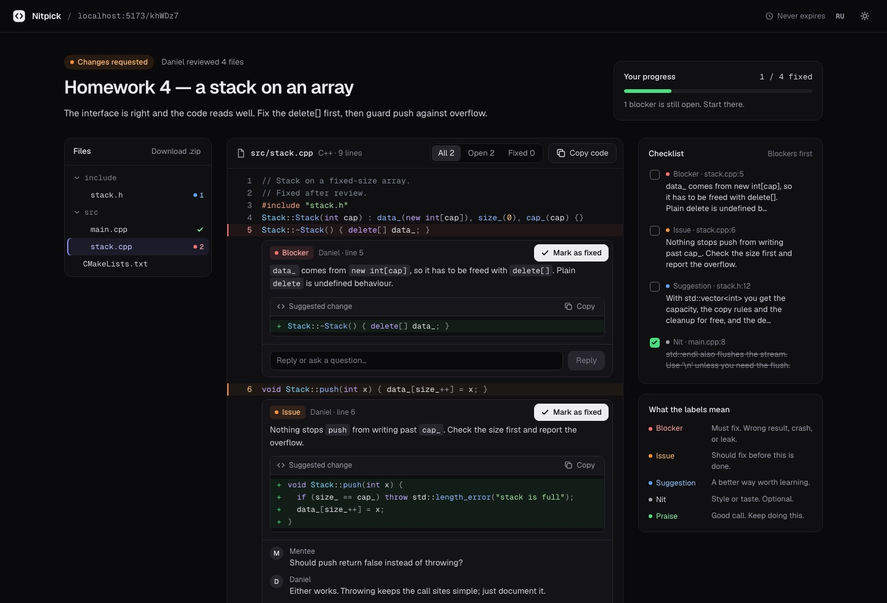
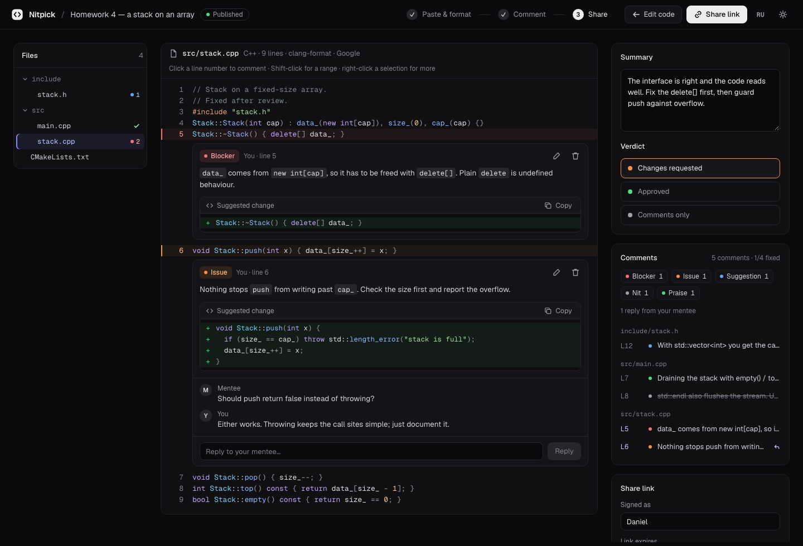
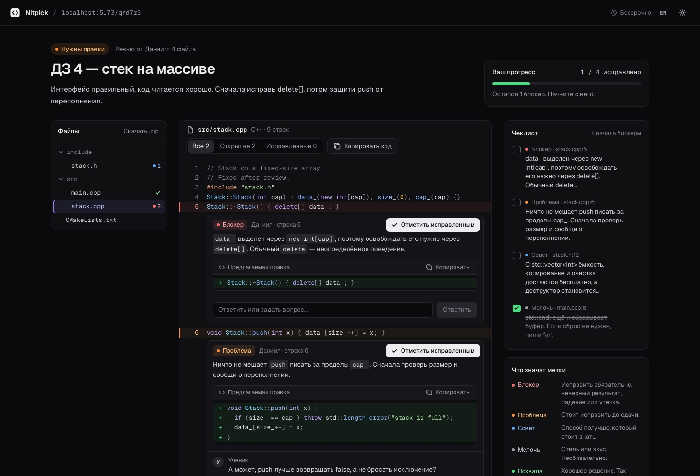
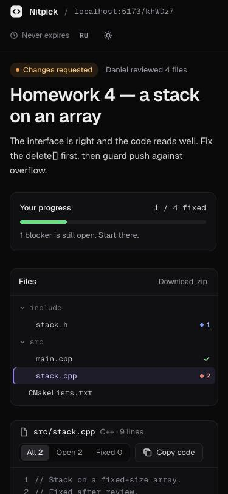
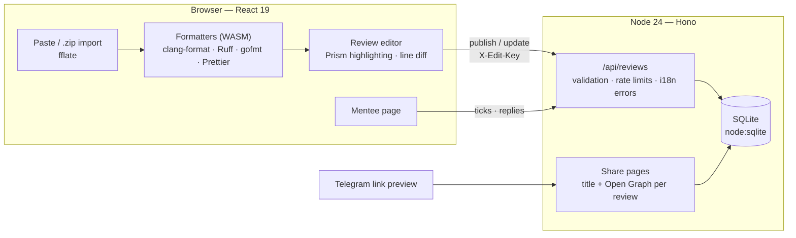

<p align="center">
  
</p>

<h1 align="center">Nitpick</h1>

<p align="center">
  <b>Code review for mentors: paste code or drop a project, comment line by line, send one short link.</b><br>
  Your mentee opens it with no account, works through the comments and ticks them off.
</p>

<p align="center">
  <a href="https://nitpick.m3105.ru"><b>🚀 Open nitpick.m3105.ru</b></a>
  &nbsp;·&nbsp;
  <a href="#-how-it-works">How it works</a>
  &nbsp;·&nbsp;
  <a href="#%EF%B8%8F-run-it-yourself">Run it yourself</a>
  &nbsp;·&nbsp;
  <a href="#-deploy">Deploy</a>
  &nbsp;·&nbsp;
  <a href="#%EF%B8%8F-architecture">Architecture</a>
</p>

<p align="center">
  <a href="https://github.com/kewldan/nitpick/actions/workflows/deploy.yml"></a>
  
  
  
  
  
  <br>
  
  
  
  
  <a href="LICENSE"></a>
</p>

<p align="center">
  
</p>

## ✨ Highlights

- 🧹 **Real formatters, in the browser.** clang-format for C++, C, Java and C# (Google, LLVM, Chromium, Mozilla, WebKit, Microsoft, GNU; indent and brace style), Ruff for Python, gofmt for Go, Prettier for TypeScript, JavaScript and JSON — compiled to WebAssembly, loaded on first use. A diff view shows exactly what changed. You review logic, not whitespace.
- 📦 **Whole projects.** Drop a `.zip` or a handful of files. `build/`, `cmake-build-*`, `.git`, `node_modules`, binaries and files over 200 KB are left out, and the page lists what was skipped and why. A file tree shows open comments per file.
- 💬 **Comments that say how much they matter.** Five fixed levels — Blocker, Issue, Suggestion, Nit, Praise. Click a line number, Shift-click for a range, or **select code and right-click**: the menu quotes the selection and can turn it into a suggested change.
- 🔗 **One short link, no accounts.** Publishing gives `nitpick.m3105.ru/k7Qx2a` for the mentee and a private edit link for you. The edit key lives in the URL fragment, so it never reaches the server's logs. Links expire after 1, 7 or 30 days, or never.
- ✅ **The mentee's side.** A progress bar, a checklist sorted blockers first, filters, “Mark as fixed”, reply threads, copy buttons for code and suggestions, and a `.zip` of the formatted project. The review opens on the file with the most pressing comment.
- 🔁 **Iterations that keep their place.** Upload the fixed version later and every comment stays on its line in every file that kept its path. Ticks and replies survive republishing.
- 🌍 **Russian and English.** The whole interface, API errors and the Telegram link preview. Russian plurals are done properly: 1 комментарий, 3 комментария, 5 комментариев.
- 🎨 **A developer tool look.** Dark and light themes from the Nitpick design system, Geist and Geist Mono, works at phone width.

> [!TIP]
> In the editor, <kbd>⌘</kbd>/<kbd>Ctrl</kbd> + <kbd>Enter</kbd> saves a comment and <kbd>Esc</kbd> cancels. In the right-click menu, <kbd>1</kbd>–<kbd>5</kbd> pick the severity.

## 📸 Screenshots

| Review editor | Русский интерфейс |
| :---: | :---: |
|  |  |

<p align="center">
  
</p>

## 🧭 How it works

1. **Paste or upload.** Paste a file, or drop a `.zip` of the project. Pick the language and style; the formatted code appears as you type.
2. **Comment.** Click a line number, Shift-click to extend to a range, or select a piece of code and right-click. Add a summary and a verdict: *Changes requested*, *Approved* or *Comments only*.
3. **Share.** Publish and copy the link, or the ready-made Telegram message. Keep the private edit link: there are no accounts, so it's the only way back in.
4. **Follow up.** The mentee's ticks and replies show up in your editor; answer in the thread. Fixed the code? Upload it again and press **Update link** — same link, comments still on their lines.

Your reviews and their progress are listed on the home page of the browser you published them from.

## 🛠️ Run it yourself

### Requirements

- [Node.js](https://nodejs.org) 24 or newer — the server uses the built-in `node:sqlite` and runs TypeScript directly, no build step for it.

### Develop

```sh
git clone https://github.com/kewldan/nitpick.git && cd nitpick
npm install
npm run dev          # http://localhost:5173, the API runs inside the Vite server
```

### Production

```sh
npm run build        # the browser app into dist/
npm start            # http://localhost:8787
```

Or in Docker:

```sh
docker build -t nitpick .
docker run -p 8787:8787 -v nitpick-data:/data nitpick
```

| Variable      | Default   | Meaning                                                    |
| ------------- | --------- | ---------------------------------------------------------- |
| `PORT`        | `8787`    | HTTP port                                                  |
| `HOST`        | `0.0.0.0` | Bind address                                               |
| `DATA_DIR`    | `./data`  | Where `nitpick.db` (SQLite) lives                          |
| `PUBLIC_URL`  | —         | Public origin, used in link previews (`og:url`)            |
| `TRUST_PROXY` | `0`       | `1` behind a reverse proxy, so rate limits see client IPs |

> [!NOTE]
> Serve it over HTTPS for anything public: copying to the clipboard needs a secure origin, and the edit links are secrets.

### Checks

The same as CI:

```sh
npm run typecheck    # tsc, including that en.ts has every key of ru.ts
npm test             # API, storage, validation, zip import, diff and i18n tests (node:test)
npm run build
```

## 🚀 Deploy

Every push to `main` runs [`.github/workflows/deploy.yml`](.github/workflows/deploy.yml): the checks, an image pushed to `ghcr.io/kewldan/nitpick`, and a rollout to the server over SSH, followed by a health check of the live site.

- The server runs the app behind a shared Traefik, which issues the Let's Encrypt certificate ([`deploy/docker-compose.yml`](deploy/docker-compose.yml)).
- The deploy key can do exactly one thing. In `authorized_keys` it is bound to [`deploy/deploy.sh`](deploy/deploy.sh) with `restrict,command=…`, which only accepts `deploy <commit sha>`, fetches that commit's compose file, pulls the image and waits for the container to become healthy.
- The registry token reaches the server on stdin and lives in a throwaway Docker config for the length of one deploy.
- Reviews are kept in the `nitpick_data` volume, so redeploys don't touch them.

## 🏗️ Architecture



- **Formatting happens in the browser.** The server stores what the mentor approved: the formatted code and the original for the diff. The heavy WASM files are split out and loaded only for the language in use.
- **One document per review.** A review is a JSON row in SQLite; every write is a synchronous read-modify-write, so it's atomic in a single process. The mentor's content and the mentee's state (ticks, replies) are merged by comment id on republish.
- **Edit keys are never stored in the clear.** The server keeps a SHA-256 hash and compares in constant time; the browser keeps your keys in `localStorage` to list your reviews.
- **Comments follow the code.** When code changes, an LCS line diff maps every old line to its new place.

<details>
<summary>🗂️ Project layout</summary>

```
server/
  app.ts           the API: publish, read, update, delete, resolve, reply, status
  store.ts         SQLite storage, ids and edit keys
  html.ts          per-review <title> and Open Graph tags
  index.ts         production entry: static files, security headers, purge of expired reviews
shared/
  types.ts         Review, ReviewFile, Comment, limits; upgrade of single-file reviews
  validate.ts      input validation with localized messages
  i18n.ts          locales, Russian plurals, the server's own messages
src/
  i18n/            ru.ts (source) and en.ts, typed against each other
  lib/             formatters, highlighting, diff, zip import/export, API client, storage
  components/      code view, comment card, composer, file tree, right-click menu, dialogs
  pages/           paste (CodeStep), review (ReviewStep), mentor flow, mentee page
  styles/          tokens.css (generated), bundle.css (design system), app.css
design/tokens.json the Nitpick design system tokens
deploy/            production compose file and the forced-command deploy script
tests/             node:test suites
```

</details>

## 🌍 Localization

Nitpick speaks **Russian** and **English**. Russian is the source language: strings live in [`src/i18n/ru.ts`](src/i18n/ru.ts), and [`src/i18n/en.ts`](src/i18n/en.ts) is checked against it with `satisfies Messages`, so a missing translation fails the typecheck. The language follows the browser (Russian for ru, uk, be and kk) and can be switched with the **RU / EN** button in the header. API errors come back in the caller's language, and a share link's Telegram preview uses the mentor's.

### Adding a programming language

Add an entry to [`src/lib/languages.ts`](src/lib/languages.ts) — Prism grammar, extension or file name, formatter — and import its grammar in [`src/lib/highlight.ts`](src/lib/highlight.ts). If it has a WASM formatter, wire it up in [`src/lib/format.ts`](src/lib/format.ts).

## 🗺️ Known limitations

- 🔁 One version per review: a re-upload replaces the code. There's no mentee-side upload and no diff between iterations yet.
- 🦀 Rust, Kotlin, SQL and config files are highlighted but not formatted — there's no WASM build of their formatters.
- 💾 An unpublished draft lives in `localStorage`; a very large project may not fit there and is lost on reload until it's published.
- 📏 Limits: 300 files, 5,000 lines per file, about 5 MB of code per review.

## 📄 License

Nitpick is released under the [MIT License](LICENSE).
